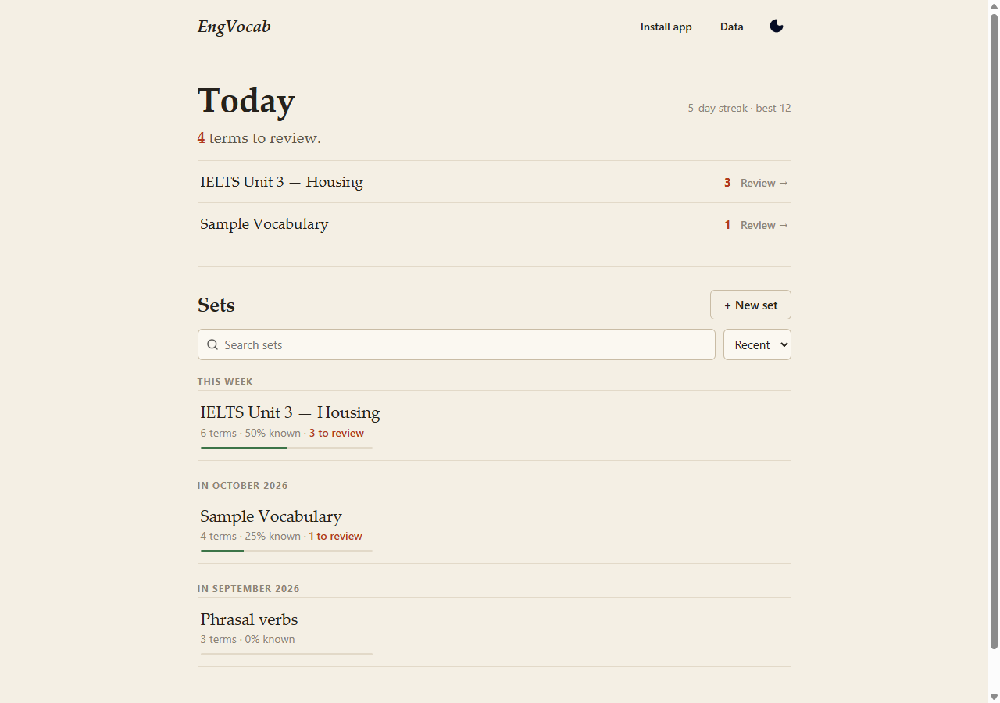
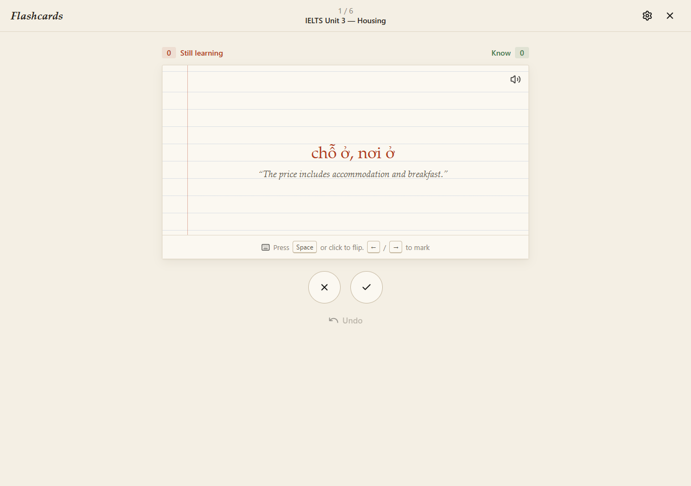
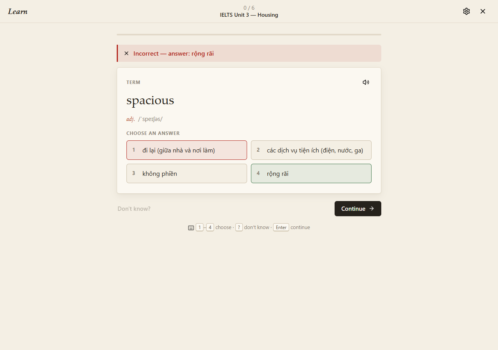
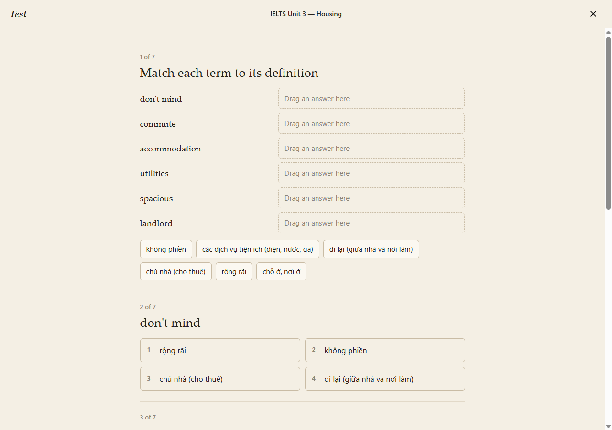

# Eng Vocab App

Ứng dụng học từ vựng tiếng Anh tối giản, chạy 100% trên trình duyệt và hỗ trợ offline hoàn toàn (không cần backend/server). Thích hợp để người học tự học, tự lưu trữ và cài đặt vĩnh viễn trên máy cá nhân.

## 🚀 Tính năng nổi bật
- **Học tập chủ động:** Tạo bộ từ, học bằng flashcard, ôn luyện với chế độ Learn, làm bài kiểm tra và theo dõi chuỗi ngày học (streak).
- **Lặp lại ngắt quãng:** Mỗi từ có lịch ôn riêng (1 → 2 → 4 → 8 → 16 → 32 ngày; trả lời sai thì quay lại từ đầu). Trang chủ và trang bộ từ hiện số từ cần ôn hôm nay, bấm **Review** để ôn đúng những từ đó.
- **Học lại từ sai:** Sau Flashcards / Learn / Test có nút học lại riêng các từ chưa thuộc hoặc làm sai.
- **Thông tin từ đầy đủ:** Ngoài nghĩa, mỗi từ có thể có loại từ, phiên âm và câu ví dụ.
- **Nhập nhanh:** Dán danh sách hoặc tải file `.txt` / `.csv` / `.tsv` (xuất từ Excel, Google Sheets, Anki), tự dịch nghĩa còn trống sang tiếng Việt.
- **Hoạt động Offline (PWA):** Có thể cài đặt ứng dụng thành phần mềm độc lập trên máy tính/điện thoại. Sau khi cài, ứng dụng hoạt động không cần mạng Internet (trừ tính năng gợi ý nghĩa).
- **Đăng nhập Google & đồng bộ:** Đăng nhập bằng Google để lưu bộ từ, tiến độ và streak vào Google Drive (thư mục ẩn của ứng dụng), dùng chung trên nhiều máy. Mở lại web vẫn giữ đăng nhập. Có thể chọn **Dùng không cần đăng nhập** — khi đó dữ liệu chỉ lưu trên trình duyệt; đăng xuất sẽ đưa dữ liệu về đúng như trước khi đăng nhập.
- **Phát âm từ vựng:** Tích hợp sẵn *Web Speech API (Text-to-Speech)* đọc tiếng Anh.
- **Giao diện thân thiện:** Dark Mode, dùng tốt trên điện thoại, phím tắt (Flashcards: Space lật thẻ, ← / → đánh dấu; Learn: 1–4 chọn đáp án, Enter tiếp tục, ? không biết).

## 📥 Định dạng nhập danh sách
Mỗi dòng một từ:
```
accommodation - chỗ ở, nơi ở
look up: tra cứu
```
Hoặc các cột cách nhau bằng Tab (dán từ Excel/Sheets) hay file CSV, theo thứ tự:
`từ | nghĩa | câu ví dụ | loại từ | phiên âm` (chỉ 2 cột đầu là bắt buộc).

## 🔄 Dùng chung dữ liệu trên nhiều máy
Đăng nhập cùng một tài khoản Google trên các máy, dữ liệu sẽ tự đồng bộ qua Google Drive.
Để chia sẻ một bộ từ cho bạn bè: trong trang bộ từ bấm nút **Share** (danh sách `từ - nghĩa`), người nhận dán vào ô nhập nhanh khi tạo bộ từ mới.

## 📱 Hướng dẫn sử dụng & Cài đặt

### Cách 1: Sử dụng và Cài đặt từ Web (Khuyên dùng)
Truy cập ứng dụng tại: **[Eng-Vocab Web](https://anlabs-cs.github.io/eng-vocab-app/)**

**Để cài đặt ứng dụng về máy tính (Dùng vĩnh viễn không cần mạng):**
1. Mở link web bằng trình duyệt **Google Chrome** hoặc **Microsoft Edge**.
2. Nhấn vào nút **"⬇ Cài App"** trên thanh menu trên cùng của ứng dụng.
3. *(Hoặc)* Nhìn lên góc bên phải của thanh địa chỉ (Address bar) của trình duyệt, bạn sẽ thấy biểu tượng màn hình máy tính có dấu `+` (Install). Nhấn vào đó.
4. Chọn **Install/Cài đặt**. Ứng dụng sẽ được tạo shortcut ngoài màn hình Desktop. Từ nay, bạn mở nó lên học bình thường kể cả khi ngắt kết nối Wifi.

### Cách 2: Chạy cục bộ trên máy (Mã nguồn tải về)
Nếu bạn tải mã nguồn gốc `.zip` về máy, bạn nên chạy ứng dụng thông qua script tích hợp sẵn để đăng nhập Google và Service Worker hoạt động đúng:
- **Trên Windows:** Nháy đúp vào file `start.bat`.
- **Trên Mac/Linux:** Mở Terminal ở thư mục gốc và chạy `./start.sh`.
- Trình duyệt sẽ tự động hướng dẫn bạn vào địa chỉ `http://localhost:8765`.

## 📸 Demo

| Danh sách bộ từ | Flashcards |
|---|---|
|  |  |

| Chế độ Learn | Chế độ Test |
|---|---|
|  |  |

## 🛠 Tech Stack
- Frontend: HTML5, CSS3, Vanilla JavaScript.
- Offline Core: Service Worker (PWA Manifest).
- Browser APIs: Web Speech API, Google Identity Services + Google Drive API (appDataFolder).
